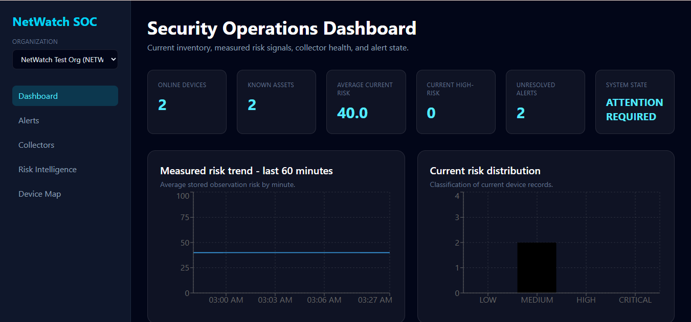
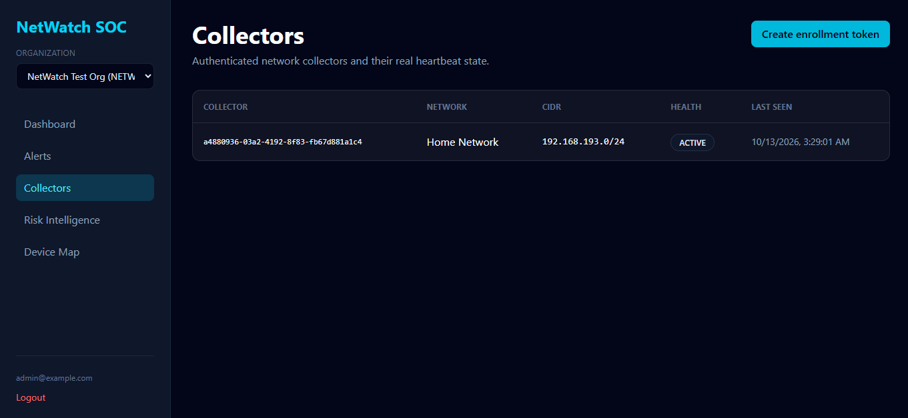
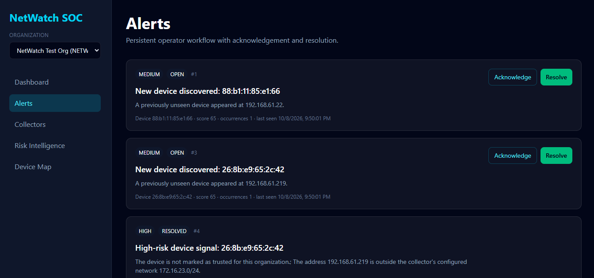
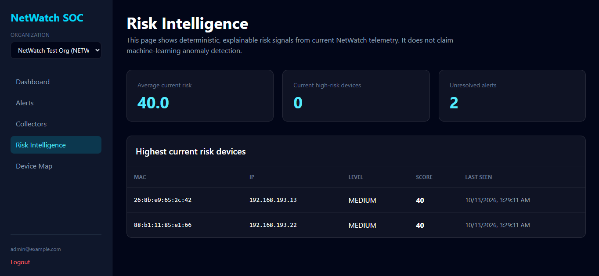
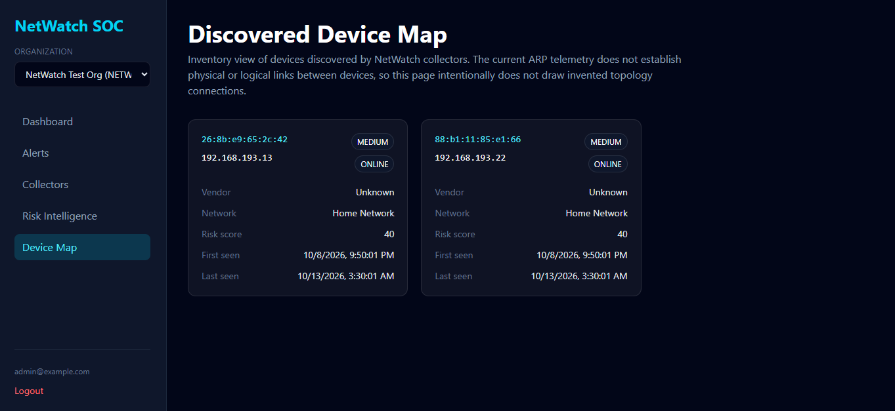
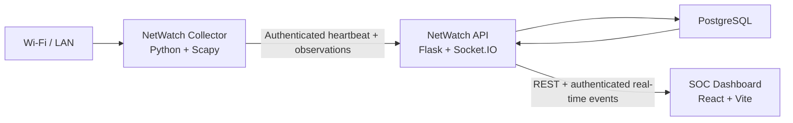

# NetWatch

> Network monitoring, device visibility and security-event detection for Wi-Fi and local-area networks.

[](https://github.com/ZikhomeChiphesi/NetWatch/actions/workflows/ci.yml)

NetWatch is a network security monitoring platform designed to help administrators discover devices connected to a local network, maintain a current asset inventory, identify suspicious or previously unseen devices, calculate risk signals, and respond to security alerts from a central dashboard.

The project combines an authenticated Python collector, a Flask API, PostgreSQL persistence, and a React/Vite security operations dashboard.

## Overview

NetWatch is built around a simple idea: network administrators should be able to see what is connected to their network, distinguish known assets from unexpected devices, and receive useful security signals without manually reviewing raw network information.

A NetWatch collector runs inside the monitored network and:

- detects its active IPv4 network automatically;
- performs ARP-based device discovery;
- sends authenticated heartbeats to the NetWatch backend;
- uploads device observations in idempotent batches;
- survives temporary backend/network failures using retry and backoff behaviour.

The backend stores observations, maintains device profiles, calculates current risk information, manages alerts, and exposes organization-scoped APIs to the dashboard.

## Screenshots

### Security Operations Dashboard



### Collectors



### Security Alerts



### Risk Intelligence



### Device Inventory



## Architecture



### Collector

The Python collector discovers devices from the active local network and communicates with the backend using an enrolled collector identity.

Collector configuration is supplied through environment variables and local state rather than being hard-coded into the source code.

### API

The Flask API provides:

- human registration and login;
- server-side authenticated sessions;
- organization-scoped access control;
- collector enrollment;
- collector authentication;
- heartbeat processing;
- idempotent device-observation uploads;
- device inventory and profile APIs;
- alert workflows;
- dashboard analytics;
- health and readiness endpoints;
- authenticated Socket.IO rooms.

### Database

PostgreSQL stores:

- organizations;
- users;
- organization memberships;
- authentication sessions;
- collectors;
- collector enrollment tokens;
- device observations;
- device inventory;
- device profiles;
- heartbeats;
- security events;
- alerts;
- upload-batch records.

Database changes are managed through versioned SQL migrations.

### Frontend

The React/Vite dashboard provides authenticated views for:

- operational network status;
- online and known devices;
- measured risk information;
- collector health;
- alerts;
- security intelligence;
- discovered device inventory.

The frontend receives periodic API updates and authenticated real-time Socket.IO events.

## Security Design

NetWatch includes several security controls that were deliberately added as the project evolved beyond its early prototype stage.

### Password security

Human passwords are stored using Werkzeug password hashing rather than plaintext credentials.

### Server-side sessions

Authenticated user sessions are represented by random tokens. Only token hashes are stored in PostgreSQL.

Logout invalidates the corresponding server-side session.

### Multi-tenant organization isolation

Users are associated with organizations through membership records.

Requests containing an organization identifier are checked against the authenticated user's membership rather than trusting the organization header alone.

### Role-based access control

Current organization roles are:

- `OWNER`
- `ADMIN`
- `OPERATOR`
- `VIEWER`

Sensitive API operations enforce role requirements at the server.

For example, collector enrollment-token creation is restricted to owners and administrators, while alert acknowledgement and resolution are available to owners, administrators and operators.

### Collector enrollment

Collectors are not allowed to register themselves arbitrarily.

An authorized user first generates a short-lived, one-time enrollment token. The collector exchanges that token for its collector identity and API credential.

The backend stores the collector API credential as a cryptographic hash rather than retaining the plaintext key.

### Idempotent uploads

Collector uploads include batch identifiers.

If the same batch is retried after a timeout or temporary network problem, the backend can recognize the duplicate instead of storing the same observation batch twice.

### Health endpoints

The API exposes:

```text
GET /health/live
GET /health/ready
```

`/health/live` confirms that the process is running.

`/health/ready` additionally verifies database connectivity and reports the migration state.

## Technology Stack

### Backend

- Python 3.12
- Flask
- Flask-CORS
- Flask-SocketIO
- Eventlet
- Gunicorn
- PostgreSQL
- psycopg2
- Scapy
- Werkzeug

### Frontend

- React
- Vite
- React Router
- Axios
- Socket.IO Client
- Recharts
- Tailwind CSS

### Engineering and deployment

- Pytest
- GitHub Actions
- Docker
- Docker Compose
- PostgreSQL 16

## Repository Structure

```text
NetWatch/
├── .github/
│   └── workflows/
│       └── ci.yml
├── docs/
│   └── screenshots/
├── frontend/
│   ├── src/
│   ├── .env.example
│   ├── package.json
│   └── package-lock.json
├── migrations/
│   └── 001_production_foundation.sql
├── src/
│   ├── agent.py
│   ├── api_server.py
│   ├── migrate.py
│   ├── network_scanner.py
│   └── threat_engine.py
├── tests/
├── .env.example
├── Dockerfile
├── docker-compose.yml
├── Procfile
├── requirements.txt
└── requirements-dev.txt
```

## Local Development

### Prerequisites

Install:

- Python 3.12+
- PostgreSQL 16+
- Node.js
- npm

Network scanning with Scapy may require administrator/root packet privileges.

### 1. Clone the repository

```bash
git clone https://github.com/ZikhomeChiphesi/NetWatch.git
cd NetWatch
```

### 2. Create the backend environment

Create a virtual environment and install the Python dependencies:

```bash
python -m venv .venv
```

Windows:

```bash
.venv\Scripts\activate
```

Linux/macOS:

```bash
source .venv/bin/activate
```

Install dependencies:

```bash
pip install -r requirements.txt
```

### 3. Configure the backend

Copy `.env.example` to `.env` and replace the example values with local credentials.

Do not commit `.env`.

Important configuration includes:

```text
DB_USER
DB_PASSWORD
DB_HOST
DB_PORT
DB_NAME
FLASK_SECRET_KEY
ALLOWED_ORIGINS
SESSION_TTL_HOURS
ALLOW_PUBLIC_SIGNUP
AGENT_STALE_SECONDS
METRICS_TOKEN
```

### 4. Apply migrations

```bash
python src/migrate.py
```

### 5. Start the API

```bash
python src/api_server.py
```

Verify:

```bash
curl http://127.0.0.1:5000/health/live
curl http://127.0.0.1:5000/health/ready
```

### 6. Start the frontend

```bash
cd frontend
npm ci
npm run dev
```

By default, the frontend can connect to:

```text
http://localhost:5000
```

A different API address can be supplied using `VITE_API_URL`.

## Collector Enrollment

Collectors use a separate authentication model from human users.

1. Sign in to NetWatch as an `OWNER` or `ADMIN`.
2. Generate a one-time collector enrollment token.
3. Configure the collector environment:

```text
NETWATCH_API_URL
NETWATCH_NETWORK_NAME
NETWATCH_ENROLLMENT_TOKEN
NETWATCH_SCAN_INTERVAL
NETWATCH_HEARTBEAT_INTERVAL
NETWATCH_REQUEST_TIMEOUT
NETWATCH_VERIFY_TLS
```

4. Start the collector:

```bash
python src/agent.py
```

After successful enrollment, the collector stores its local identity in `.netwatch_agent.json`.

That file contains sensitive collector state and is excluded from Git.

The one-time enrollment token should then be removed from the collector environment.

## Testing

Create a dedicated PostgreSQL test database and set `TEST_DATABASE_URL`.

NetWatch intentionally refuses to run the test suite without an explicit test database configuration so that tests cannot accidentally truncate a normal application database.

Run:

```bash
pytest -q
```

Coverage:

```bash
pytest -q --cov=src --cov-report=term-missing
```

The current local validation suite contains 14 passing backend tests covering authentication, tenant isolation, RBAC, collector enrollment, uploads, duplicate-batch protection, alert lifecycle behaviour, and threat-engine behaviour.

Frontend checks:

```bash
cd frontend
npm ci
npm run lint
npm run build
npm audit --omit=dev
```

At the current validated revision:

- backend tests: **14 passed**;
- measured Python coverage: **51%**;
- frontend lint: **passing**;
- frontend production build: **passing**;
- production npm audit: **0 known vulnerabilities**.

## Continuous Integration

GitHub Actions validates pull requests and pushes to `main`.

The CI workflow:

1. starts PostgreSQL 16;
2. installs Python dependencies;
3. applies database migrations;
4. runs backend tests with coverage;
5. installs frontend dependencies with `npm ci`;
6. runs ESLint;
7. builds the production frontend.

## Docker

For local container-based development:

```bash
docker compose up --build
```

The Compose configuration starts PostgreSQL and the NetWatch API.

Production deployments should supply real secrets through environment configuration rather than using the development defaults.

## Current Scope and Limitations

NetWatch is an actively developed security-monitoring project rather than a replacement for an enterprise SIEM, NAC or IDS platform.

Current limitations include:

- the collector focuses primarily on local IPv4/ARP visibility;
- physical or logical network links are not inferred from ARP observations;
- the device map therefore avoids inventing topology relationships;
- packet-level intrusion detection is outside the current scope;
- collector/network-scanner automated coverage is still an area for improvement;
- frontend bundle code-splitting can be improved as the dashboard grows.

These limitations are intentionally documented so that the dashboard does not imply capabilities the underlying telemetry cannot support.

## Roadmap

Planned areas for continued development include:

- additional collector integration tests;
- richer device fingerprinting;
- improved anomaly and behavioral baselining;
- notification integrations;
- improved alert filtering and investigation workflows;
- deployment hardening and observability;
- frontend bundle code-splitting;
- expanded network telemetry beyond ARP discovery.

## Project Motivation

NetWatch began as an exploration of practical network monitoring and has evolved into a larger cybersecurity engineering project focused on:

- secure authentication;
- multi-tenant authorization;
- resilient collectors;
- network visibility;
- security-event handling;
- relational data modeling;
- API design;
- frontend operations tooling;
- automated testing;
- deployment engineering.

The goal is to continue developing NetWatch into a practical monitoring platform while using the project to demonstrate hands-on cybersecurity, networking, backend, database and frontend engineering skills.
